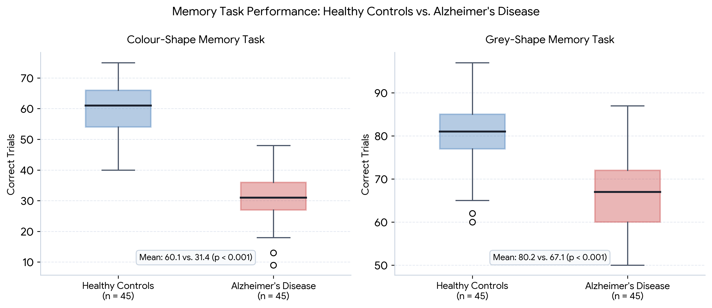
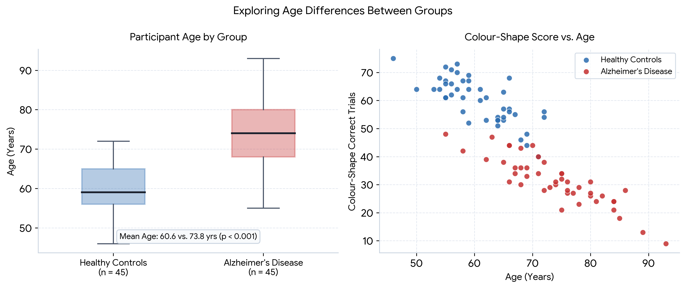

# Alzheimer's Disease Memory Task Analysis (R)

Exploratory data analysis and statistical comparison of visual memory performance in Alzheimer's disease patients ($n = 45$) versus healthy controls ($n = 45$), built in **R**.

### Questions Explored

1. **Sample Balance:** Is the dataset balanced between Alzheimer's patients and healthy controls, and across gender?
2. **Task Performance:** How much do the two groups differ on the **Colour-Shape Task** and **Grey-Shape Task**, and are the differences statistically significant?
3. **Age & Demographic Comparison:** Are the two groups similar in age, or could age differences also contribute to the lower test scores?

*Background:* This project started as a university Probability & Statistics assignment in R. This repository organizes the analysis into a clean, reproducible script (`src/analysis.R`), adds two-sample $t$-tests with confidence intervals, and highlights an important age difference between the two groups.

---

### Key Findings

| Variable | Healthy Controls ($n=45$) | Alzheimer's Disease ($n=45$) | Difference (Healthy − AD) | 95% Confidence Interval | Two-Sample $t$-test |
| :--- | :---: | :---: | :---: | :---: | :---: |
| **Colour-Shape Task** | $60.1 \pm 8.0$ | $31.4 \pm 8.5$ | **$+28.7$ pts** | $+25.2$ to $+32.2$ | $t = 16.45, p < 0.001$ |
| **Grey-Shape Task** | $80.2 \pm 8.1$ | $67.1 \pm 8.5$ | **$+13.1$ pts** | $+9.6$ to $+16.6$ | $t = 7.49, p < 0.001$ |
| **Age (Years)** | $60.6 \pm 6.0$ | $73.8 \pm 8.1$ | **$-13.2$ yrs** | $-16.2$ to $-10.2$ | $t = -8.79, p < 0.001$ |

* **Balanced Sample:** The dataset contains $90$ participants ($6$ variables, $0$ missing values), evenly split between $45$ Alzheimer's patients and $45$ healthy controls. Gender is also balanced ($25$ female / $20$ male in Alzheimer's vs. $23$ female / $22$ male in healthy controls).
* **Memory Task Gap:** Healthy controls score significantly higher on both tasks, especially on the **Colour-Shape Task** ($60.1$ vs. $31.4$ correct trials, $p < 0.001$), which requires remembering both colour and shape together.
* **Age Difference Between Groups:** Comparing the group summary tables shows that the Alzheimer's group is **$13.2$ years older on average** ($73.8$ vs. $60.6$ years, $p < 0.001$). As shown in the scatterplot below, test scores tend to decline with age across both groups—meaning age is an important factor to keep in mind when interpreting the raw group gap.





---

### Method

1. **Data Inspection:** Checked dimensions ($90 \times 6$), variable types, missing values, and group counts using `table()` and `summary()`.
2. **Group Comparison:** Computed summary statistics (mean, standard deviation, median, min, max) separately for Alzheimer's patients and healthy controls.
3. **Hypothesis Testing:** Ran two-sample $t$-tests (`t.test()`) with 95% confidence intervals to test whether group differences in test scores and age are statistically significant.
4. **Visualisation:** Created side-by-side boxplots and a scatterplot to compare score distributions and inspect the relationship with age.

---

### Limitations

* **Age Imbalance:** Healthy controls range from $46$ to $72$ years old, whereas Alzheimer's patients range from $55$ to $93$ years old. Because the two groups are not matched by age, part of the observed score difference may reflect normal aging alongside Alzheimer's disease.
* **Small Sample Size:** With $90$ total participants and no additional clinical variables (such as education level or disease stage), findings are descriptive and exploratory.

---

### Reproduce

Run the R script from the root of the repository (uses standard base R functions with no extra packages required):

```bash
Rscript src/analysis.R
```

---

### Repository Structure

```text
├── data/
│   └── AlzheimersData.csv          # Dataset (90 observations, 6 variables)
├── src/
│   └── analysis.R                  # Clean, reproducible R analysis script
├── report/
│   └── Alzheimers_Analysis.Rmd     # R Markdown report
├── figures/                        # Boxplots and scatterplot used in README
├── results/                        # Summary statistics and t-test tables (.csv)
├── .gitignore                      # Ignores .Rhistory, .RData, and temp files
└── README.md
```
